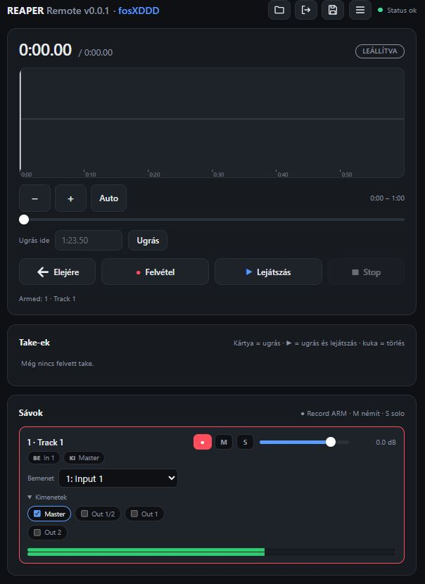
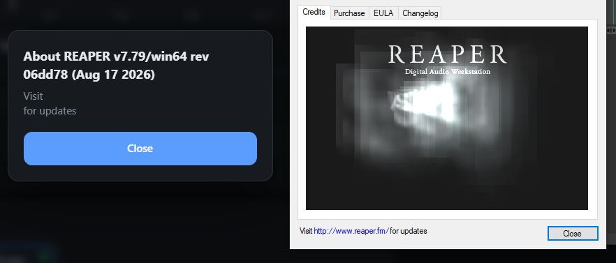
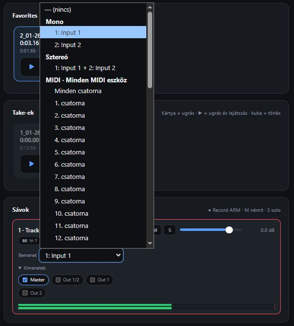
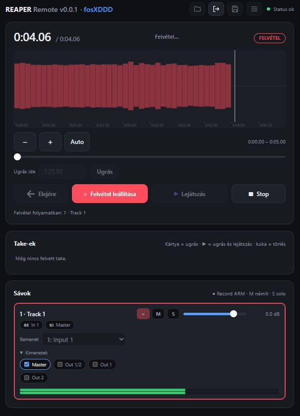
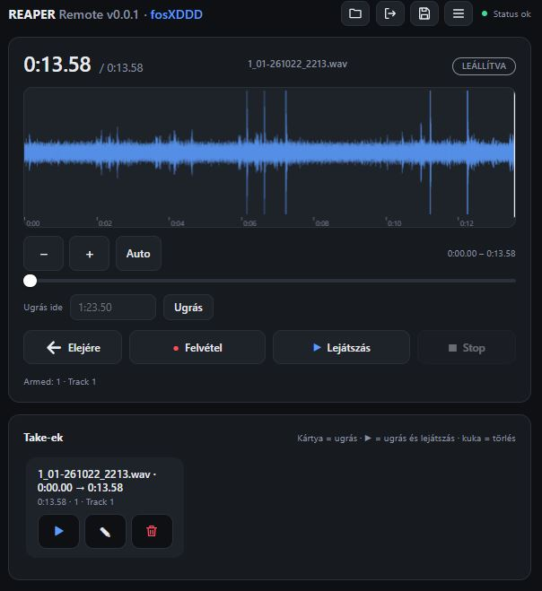
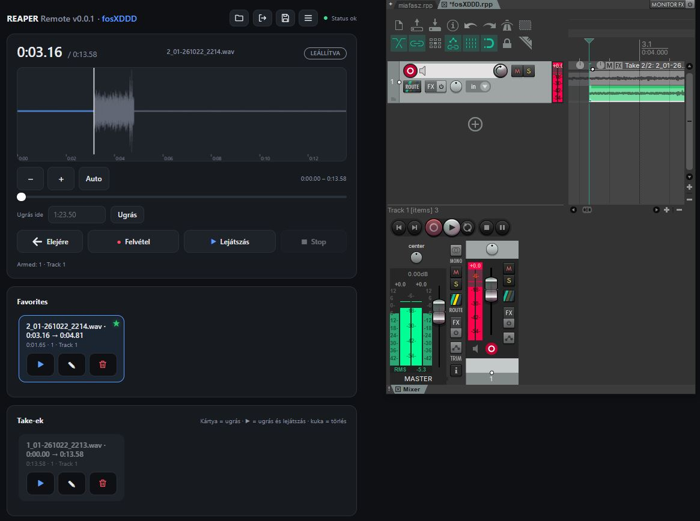

# REAPER Web Controller

[Magyar](#magyar) | [English](#english)

---

## Screenshots / Képernyőképek

<table>
  <tr>
    <td></td>
    <td></td>
    <td></td>
  </tr>
  <tr>
    <td></td>
    <td></td>
    <td></td>
  </tr>
</table>

---

## Magyar

Webes kezelőfelület a REAPER-hez. A Flask alapú szerver a [python-reapy](https://github.com/RomeoDespres/reapy) segítségével kommunikál a futó REAPER példánnyal, így a projekt nagy része böngészőből állítható: sávok, hangerők, routing, projekt mentése és a projekt hullámformájának megjelenítése.

Beépített mock backend is van, így a felület REAPER nélkül is kipróbálható és tesztelhető.

### Főbb jellemzők

- Take kezelés, sávon belül ha veszel újat majd kedvencek közé rakja duplakattal meg zöldre is színezi a sávot ha 63. alkalommal lesz jó a sáv lehessen már látni melyik jó :d
- Webes UI egyszerű, egyoldalas felülettel
- Kommunikáció a REAPER-rel a ReaScript API-n keresztül (helyi socket, `python-reapy`)
- Cserélhető backend: valódi REAPER vagy memóriában futó mock
- Egyszerű belépés `users.json` alapján, session cookie-val
- Hangerő kezelése dB-ben a felületen (a REAPER lineáris gain-t tárol)
- Áttekintő hullámforma a projekt audio elemeiből
- Szerver oldali mappaböngészés a Save Project mappaválasztóhoz
- A REAPER saját (Windows) párbeszédablakainak kiolvasása és gombnyomás (csak Windowson)
- Színes konzolos naplózás

### Követelmények

- Python 3.11
- REAPER (a valódi backendhez)

### Telepítés

```bash
git clone <repo-url>
cd <repo-mappa>

python -m venv .venv
# Windows:
.venv\Scripts\activate
# Linux / macOS:
source .venv/bin/activate

pip install -r requirements.txt
```

### REAPER beállítása

A valódi backendhez a REAPER-ben engedélyezni kell a Python támogatást, majd egyszer le kell futtatni a reapy konfigurálását:

```bash
python -c "import reapy; reapy.configure_reaper()"
```

Ezután indítsd újra a REAPER-t. A reapy részletes leírása a [dokumentációjában](https://python-reapy.readthedocs.io/) található.

### Felhasználók

A belépés a `users.json` fájlon alapul. Ez a fájl jelszavakhoz kapcsolódó adatokat tartalmaz. Töltsd ki a saját adataiddal:

```bash
cp dummy_users.json users.json
```

### Indítás

```bash
python run.py
```

Ezután a szerver a konzolon kiírt címen érhető el böngészőből.

### Automatikus indítás a REAPER-rel (Windows)

A szerver úgy is beállítható, hogy a REAPER indulásakor magától elinduljon, terminálablak nélkül. Ehhez két fájl kell.

`start_hidden.vbs` (a projekt mappájában): rejtett ablakban elindítja a szervert, a kimenetet pedig a `server.log` fájlba írja.

```vbs
CreateObject("WScript.Shell").Run "cmd /c cd /d ""C:\YourProjectDir\reaper-web"" && ""C:\YourProjectDir\reaper-web\venv.venv\Scripts\python.exe"" run.py >> server.log 2>&1", 0, False
```

`__startup.lua` (a REAPER Scripts mappájában, jellemzően `%APPDATA%\REAPER\Scripts\`): a REAPER minden induláskor lefuttatja, és ez hívja meg a VBS fájlt.

```lua
local dir = [[C:\YourProjectDir\reaper-web]]
reaper.ExecProcess('wscript.exe "' .. dir .. [[\start_hidden.vbs"]], -2)
```

A `C:\YourProjectDir\reaper-web` útvonalat és a virtuális környezet nevét írd át a saját gépedre. A szerver naplója a `server.log` fájlban követhető.

### Projektfelépítés

```
.
├── run.py                 Belépési pont, a szerver indítása
├── start_hidden.vbs       Rejtett indítás (terminál nélkül)
├── users.json             Felhasználók (nincs verziókezelve)
└── app/
    ├── __init__.py        Flask app létrehozása, hibakezelő
    ├── web.py             HTTP réteg: bemenet ellenőrzése, JSON válaszok
    ├── services.py        Alkalmazáslogika a backend fölött
    ├── auth.py            Belépés: users.json + session cookie
    ├── models.py          Közös adatobjektumok
    ├── errors.py          HTTP státuszra képezhető hibák
    ├── units.py           dB és lineáris gain átváltás, routing segédek
    ├── waveform.py        Áttekintő hullámforma (peak-ek)
    ├── filesystem.py      Mappabögészés a Save Project-hez
    ├── dialogs.py         REAPER párbeszédablakok kezelése (Windows)
    ├── logs.py            Színes konzolos naplózás
    ├── backends/
    │   ├── base.py            DawBackend absztrakt interfész
    │   ├── reapy_backend.py   Valódi REAPER backend
    │   └── mock_backend.py    Memóriában futó hamis DAW
    ├── static/
    │   └── app.js         Frontend logika
    └── templates/
        └── index.html     Egyoldalas felület
```

### Architektúra

A rétegek egyirányúak: a web réteg csak a service-t hívja, a service pedig a `DawBackend` interfészen keresztül éri el a DAW-ot. Emiatt a `reapy_backend` és a `mock_backend` szabadon cserélhető, és a teljes alkalmazás tesztelhető REAPER nélkül.

```
böngésző  ->  web.py  ->  services.py  ->  DawBackend  ->  REAPER (reapy) / mock
```

### Biztonság

- A felületet csak megbízható hálózaton futtasd, mert a REAPER teljes vezérlését kiadja.

### Licenc

MIT licenc, a részleteket lásd a [LICENSE](LICENSE) fájlban.

### Megjegyzés

Ez egy Claude-dal összehányt, vibekódolt projekt, szóval a kód minősége olyan, amilyen. Cserébe viszonylag könnyedén konfigurálható és átalakítható. Működik, másra nem is kell, és csak egy felhasználóra van szabva.

---

## English

A web interface for REAPER. The Flask based server talks to a running REAPER instance through [python-reapy](https://github.com/RomeoDespres/reapy), so most of the project can be controlled from a browser: tracks, volumes, routing, saving the project and viewing the project's waveform.

A built-in mock backend is included, so the UI can be tried out and tested without REAPER.

### Features

- Web UI with a simple single-page interface
- Communication with REAPER through the ReaScript API (local socket, `python-reapy`)
- Swappable backend: real REAPER or an in-memory mock
- Simple login based on `users.json`, using a session cookie
- Volume is handled in dB in the UI (REAPER stores linear gain)
- Overview waveform built from the project's audio items
- Server-side folder browsing for the Save Project folder picker
- Reading REAPER's own (Windows) dialog windows and pressing their buttons (Windows only)
- Colored console logging

### Requirements

- Python 3.11
- REAPER (for the real backend)

### Installation

```bash
git clone <repo-url>
cd <repo-folder>

python -m venv .venv
# Windows:
.venv\Scripts\activate
# Linux / macOS:
source .venv/bin/activate

pip install -r requirements.txt
```

### Setting up REAPER

For the real backend, Python support has to be enabled in REAPER, and the reapy configuration has to be run once:

```bash
python -c "import reapy; reapy.configure_reaper()"
```

Then restart REAPER. More details are in the [reapy documentation](https://python-reapy.readthedocs.io/).

### Users

Login is based on the `users.json` file. It contains password related data. Fill it in with your own data:

```bash
cp dummy_users.json users.json
```

### Running

```bash
python run.py
```

The server is then available in the browser at the address printed in the console.

### Starting automatically with REAPER (Windows)

The server can be set up to start by itself when REAPER launches, without showing a terminal window. Two files are needed.

`start_hidden.vbs` (in the project folder): starts the server in a hidden window and writes its output to `server.log`.

```vbs
CreateObject("WScript.Shell").Run "cmd /c cd /d ""C:\YourProjectDir\reaper-web"" && ""C:\YourProjectDir\reaper-web\venv.venv\Scripts\python.exe"" run.py >> server.log 2>&1", 0, False
```

`__startup.lua` (in REAPER's Scripts folder, usually `%APPDATA%\REAPER\Scripts\`): REAPER runs it on every startup, and it calls the VBS file.

```lua
local dir = [[C:\YourProjectDir\reaper-web]]
reaper.ExecProcess('wscript.exe "' .. dir .. [[\start_hidden.vbs"]], -2)
```

Change the `C:\YourProjectDir\reaper-web` path and the virtual environment name to match your machine. The server log can be followed in `server.log`.

### Project structure

```
.
├── run.py                 Entry point, starts the server
├── start_hidden.vbs       Hidden launcher (no terminal window)
├── users.json             Users (not under version control)
└── app/
    ├── __init__.py        Flask app factory, error handler
    ├── web.py             HTTP layer: input validation, JSON responses
    ├── services.py        Application logic on top of the backend
    ├── auth.py            Login: users.json + session cookie
    ├── models.py          Shared data objects
    ├── errors.py          Errors that map to an HTTP status
    ├── units.py           dB and linear gain conversion, routing helpers
    ├── waveform.py        Overview waveform (peaks)
    ├── filesystem.py      Folder browsing for Save Project
    ├── dialogs.py         Handling REAPER dialog windows (Windows)
    ├── logs.py            Colored console logging
    ├── backends/
    │   ├── base.py            DawBackend abstract interface
    │   ├── reapy_backend.py   Real REAPER backend
    │   └── mock_backend.py    In-memory fake DAW
    ├── static/
    │   └── app.js         Frontend logic
    └── templates/
        └── index.html     Single-page UI
```

### Architecture

The layers are one-directional: the web layer only calls the service, and the service reaches the DAW through the `DawBackend` interface. This makes `reapy_backend` and `mock_backend` freely swappable, and the whole application testable without REAPER.

```
browser  ->  web.py  ->  services.py  ->  DawBackend  ->  REAPER (reapy) / mock
```

### Security

- Only run the UI on a trusted network, as it exposes full control of REAPER.
- Do not commit `users.json` or the session secret key.

### License

MIT license, see the [LICENSE](LICENSE) file for details.

### Note

This is a vibe-coded mess thrown together with Claude, so code quality is what it is. On the upside, it is fairly easy to configure and rework. It works, nothing more is needed, and it is built for a single user only.
